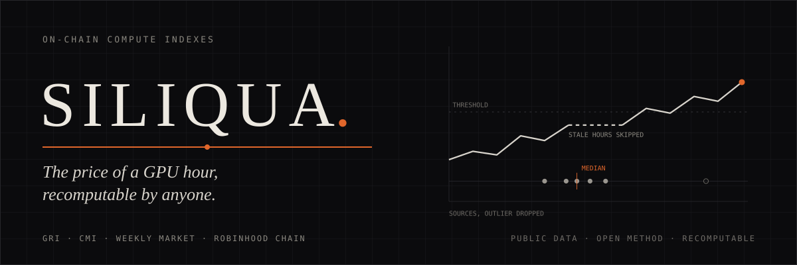

<div align="center">



# SILIQUA

**On-chain compute indexes and a weekly prediction market**

_The price of a GPU hour, recomputable by anyone._

`GRI` GPU rent in USD per GPU-hour &nbsp;·&nbsp; `CMI` compute narrative share in bps &nbsp;·&nbsp; Robinhood Chain (EVM) &nbsp;·&nbsp; Status: **pre-release, interim README**

</div>

---

Siliqua publishes two indexes on Robinhood Chain and runs a weekly YES/NO market on top of them.

- **GRI (GPU Rent Index)** is the median on-demand rental price of a GPU class, in USD per GPU-hour, with 6 decimals. Classes: H100 80GB SXM, H200 SXM, B200, A100 80GB, RTX 4090 24GB.
- **CMI (compute narrative share)** is the share of social attention held by each compute narrative, from 0 to 10,000 bps.
- **Market**: a weekly parimutuel market in USDG. It closes 24 hours before a 24-hour TWAP window of the hourly GRI, and the TWAP settles it.

Both indexes are pure functions of public raw data. The raw data is exported monthly with a SHA-256 manifest, and a `verify` script recomputes any published hour from it.

Siliqua indexes are published data, not investment advice. Nothing here is a statement of fact about any provider, and no provider endorses it.

## Status

This repository is in **Stage 2: backend, data and API**. Nothing is deployed and no money is handled.

| Part                                    | State                                                                                                                          |
| --------------------------------------- | ------------------------------------------------------------------------------------------------------------------------------ |
| Index math (`packages/siliqua-index`)   | Done. Integer arithmetic, shared golden vectors, property tests                                                                |
| Price collectors                        | Done for 5 providers (RunPod, Vast.ai, Lambda, Texel, Akash). Each is off unless switched on                                   |
| Index engine                            | Done. Computes every complete hour, stores stale hours, immutable once published                                               |
| Database                                | Done locally. Plain Postgres, monthly partitions, row-level security on every table                                            |
| API (`services/api`)                    | Done. `/v1/indexes`, `/v1/indexes/:slug`, rate limited. Redis cache not yet added                                              |
| Frontend (`apps/web`)                   | Reads index data from the API when `API_BASE_URL` is set. Markets read the API and the chain once `CHAIN_ENV` (testnet or mainnet), `RPC_URL` and `FACTORY_ADDRESS` are also set, and the ticket talks to a browser wallet; narratives stay on labelled sample data |
| Watchdog                                | Done. Coverage gaps per class, source freshness, webhook alert                                                                 |
| Export and `verify`                     | Done                                                                                                                           |
| CMI, oracle contracts, market contracts | Not started (later stages)                                                                                                     |

**Not yet publishable.** A GRI class is published only with at least 5 valid sources after the outlier filter. With the current providers no class reaches that with independent sources, so every index reports `INSUFFICIENT_SOURCES`. The stage gate also needs 30 days with no raw-coverage gap over 6 hours, which has not started. The methodology draft is in [docs/methodology/gri-v1.0.md](docs/methodology/gri-v1.0.md).

## How an index is computed

1. Collectors read public prices from each source every 10 minutes and store the raw observations with a payload hash.
2. For each class and hour, each source contributes one quote (the median of its observations in that hour).
3. Quotes beyond `3 * max(1.4826 * MAD, 1% of median)` from the median are dropped.
4. With at least 5 quotes left, the GRI is their median. Otherwise the hour is not published.
5. The market settles on the 24-hour TWAP of the hourly GRI. Empty hours are skipped and counted as stale. More than 6 stale hours in the window voids the market with a full refund.

All arithmetic is integer micro-USD with half-up rounding. No floating point touches a price.

## Trust model

Three oracle operators, all from the Siliqua team, sign their own values on-chain (EIP-712). The contract drops values more than 1% from the median and needs at least 2 left. There is **no stake and no slashing in v1**. This is trust in one team, not economic security, and it is stated on the oracle and methodology pages. Market contracts are immutable and pin the oracle address at creation. Admin actions go through a multisig and a timelock, and a pause never blocks claims or refunds.

## Repository

```
apps/web                  Next.js frontend
services/api              Fastify read API
packages/siliqua-index    Pure index functions, shared by engine and oracle node
workers/price-collectors  Provider collectors
workers/index-engine      Hourly computation, monthly export, verify
workers/watchdog          Coverage and freshness alerts
db/migrations             Plain SQL migrations
test-vectors              Golden vectors shared by every consumer
docs                      Brief, plan, roadmap, sources, methodology
```

Stack: TypeScript (Next.js, Fastify), Python 3.12, Postgres, Solidity with Foundry. Workspaces are pnpm for TypeScript and uv for Python.

## Run it locally

Needs Node, pnpm, uv and Docker.

```bash
cp .env.example .env              # set POSTGRES_PASSWORD, DATABASE_URL, provider keys
docker compose up -d              # local Postgres, migrations apply on first start
pnpm install
uv sync --all-packages

# collect, compute, serve
uv run python -m price_collectors --once
uv run python -m index_engine --once
pnpm --filter @siliqua/api start

# frontend against the API
API_BASE_URL=http://127.0.0.1:8080 pnpm --filter web dev
```

Providers are off by default. Set `COLLECTOR_<NAME>_ENABLED=true` and the key where one is needed. Vast.ai and RunPod terms bar use in an index without a written agreement, so those two are for internal testing only. Provider terms are tracked in [docs/sources.md](docs/sources.md).

Export a month and recompute it without a database:

```bash
uv run python -m index_engine.export 2026-11 ./export
uv run python -m index_engine.verify ./export --sample 100
```

Checks:

```bash
pnpm lint && pnpm typecheck && pnpm --filter @siliqua/api test
DATABASE_URL=... uv run pytest db packages workers
```

## Documents

- [Developer brief](docs/brief/Siliqua%20Developer%20Brief.md)
- [Implementation plan](docs/PLAN.md) and [roadmap](docs/ROADMAP.md)
- [GRI methodology v1.0 (draft)](docs/methodology/gri-v1.0.md)
- [Data sources and terms](docs/sources.md)

## Out of scope

The $SILQ token and its launch are not part of this repository. Its address is read from configuration only. Chain IDs and the USDG address are configuration with a `verified` flag and are not filled in until checked against official Robinhood Chain documentation.

## License

Not yet chosen.
