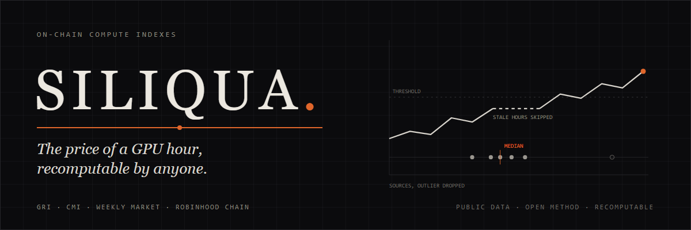

<div align="center">



# SILIQUA

**On-chain compute indexes and a weekly prediction market**

_The price of a GPU hour, recomputable by anyone._

[Website](https://siliqua.tech) &nbsp;·&nbsp; [X](https://x.com/SiliquaCompute) &nbsp;·&nbsp; [Contracts](contracts/announcement.md) &nbsp;·&nbsp; Status: **running on Robinhood Chain Testnet, not audited**

</div>

---

Siliqua computes two indexes and runs a weekly YES/NO market on top of the GPU rent index.

- **GRI (GPU Rent Index)** is the on-demand rental price of a GPU class, averaged across sources after outliers are dropped, in USD per GPU-hour with 6 decimals. Classes: H100 80GB SXM, H200 SXM, B200, A100 80GB, RTX 4090 24GB. Signed values are stored on chain.
- **CMI (compute narrative share)** is the share of social attention held by each compute narrative, from 0 to 10,000 bps. It is computed daily and served by the API. It is not published on chain.
- **Market**: a weekly parimutuel market in test USDG. It closes 24 hours before a 24-hour TWAP window of the hourly GRI, and the TWAP settles it.

Siliqua indexes are published data, not investment advice. Nothing here is a statement of fact about any provider, and no provider endorses it.

## Status

Testnet only (chain ID 46630). Test tokens have no value. Mainnet is not deployed.

| Part                                     | State                                                                                                                                         |
| ---------------------------------------- | --------------------------------------------------------------------------------------------------------------------------------------------- |
| Website (`apps/web`)                     | Live on Vercel: indexes, narratives, markets, portfolio, methodology, oracle, data, docs, whitepaper and FAQ pages. Wallet connect, buy, claim and refund on testnet |
| API (`services/api`)                     | Live. Indexes, narratives, markets and oracle status, rate limited                                                                            |
| Price collectors, index engine, watchdog | Running. A class is published only with at least 5 valid sources after the outlier filter; otherwise the hour is marked and not published     |
| CMI                                      | Farcaster and Bluesky, keyword classifier. X is off. The 500-post evaluation of the classifier is not done                                    |
| Oracle contract and 3 operator nodes     | Running on testnet                                                                                                                            |
| Relayer, indexer, market keeper          | Running on testnet                                                                                                                            |
| Market contracts and fee router          | Deployed on testnet                                                                                                                           |
| Contract audit, legal review             | Not done. Both are gates before mainnet                                                                                                       |
| Mainnet admin (multisig and timelock)    | Not built. One key stands in on testnet                                                                                                       |

Addresses, deploy transactions, source verification status and trust boundaries are listed in [contracts/announcement.md](contracts/announcement.md). The methodology is still a draft: [GRI](docs/methodology/gri-v1.0.md), [CMI](docs/methodology/cmi-v1.0.md).

## How GRI is computed

1. Collectors read prices from each source every 10 minutes and store the raw observations with a payload hash.
2. For each class and hour, each source contributes one quote (the median of its observations in that hour).
3. Quotes further than `3 * max(1.4826 * MAD, 1% of median)` from the median are dropped.
4. With at least 5 quotes left, the GRI is their mean (every weight is 1 in v1.0), rounded half up. Otherwise the hour is not published.
5. The market settles on the 24-hour TWAP of the hourly GRI. Empty hours are skipped and counted as stale. More than 6 stale hours in the window voids the market with a full refund.

All arithmetic is integer micro-USD with half-up rounding. No floating point touches a price. A monthly export with a SHA-256 manifest and a `verify` script recompute published hours without a database.

## Trust model

Three oracle operators, all from the Siliqua team, sign their own values (EIP-712). The contract drops values more than 1% from the median and needs at least 2 left. There is **no stake and no slashing in v1**. This is trust in one team, not economic security. Market contracts are immutable and pin the oracle address at creation. Pausing stops buying only; it never blocks claims or refunds.

## Repository

```
apps/web                   Next.js frontend
services/api               Fastify API and oracle report relayer
services/indexer           Reads oracle and market events into Postgres
services/market-keeper     Creates and settles the weekly markets
packages/siliqua-index     Pure index functions, shared by the engine and the oracle node
packages/chain             Chain and token configuration with a verified flag per value
packages/db                Database types and migrations runner
workers/price-collectors   Provider collectors
workers/social-collectors  Farcaster and Bluesky collectors for CMI
workers/index-engine       Hourly GRI, daily CMI, monthly export, verify
workers/oracle-node        One per operator: computes and signs
workers/watchdog           Coverage and freshness alerts
contracts                  Solidity contracts and Foundry tests
db/migrations              Plain SQL migrations
test-vectors               Golden vectors shared by every consumer
docs                       Brief, plan, specs, methodology, sources, runbooks
```

Stack: TypeScript (Next.js, Fastify, viem), Python 3.12, Postgres, Solidity with Foundry. Workspaces are pnpm for TypeScript and uv for Python.

## Run it locally

Needs Node 26, pnpm, uv, Python 3.12 and Docker. Foundry is needed only for the contracts. The services read environment variables and do not load `.env` themselves, so export it first.

```bash
git clone --recurse-submodules https://github.com/siliqua-labs/siliqua-protocol.git
cd siliqua-protocol
cp .env.example .env              # set POSTGRES_PASSWORD, DATABASE_URL and provider keys
set -a; . ./.env; set +a
docker compose up -d              # local Postgres, migrations apply on first start
pnpm install
uv sync --all-packages --python 3.12

uv run python -m price_collectors --once
uv run python -m index_engine --once
pnpm --filter @siliqua/api start
```

Frontend, in a second terminal:

```bash
API_BASE_URL=http://127.0.0.1:8080 pnpm --filter @siliqua/web dev
```

Without `API_BASE_URL` the pages show labelled sample data. Markets are live only when `CHAIN_ENV`, `RPC_URL` and `FACTORY_ADDRESS` are set as well.

Providers are off by default. Set `COLLECTOR_<NAME>_ENABLED=true` and the key where one is needed. Several providers need written permission before their prices may feed a published index. Read [docs/sources.md](docs/sources.md) before enabling any of them.

Export a month and recompute it without a database (replace the month):

```bash
uv run python -m index_engine.export 2026-11 ./export
uv run python -m index_engine.verify ./export --sample 100
```

## Checks

```bash
pnpm lint
pnpm typecheck
pnpm -r test
DATABASE_URL=... uv run --python 3.12 pytest db packages workers
cd contracts && forge test
```

## Documents

- [Developer brief](docs/brief/Siliqua%20Developer%20Brief.md)
- [Implementation plan](docs/PLAN.md) and [roadmap](docs/ROADMAP.md)
- [Oracle spec](docs/spec/oracle-v1.md) and [market spec](docs/spec/market-v1.md)
- [Reading GRI from a contract or the API](docs/consuming-the-index.md)
- [Data sources and terms](docs/sources.md)
- [Testnet deploy](docs/testnet-deploy.md) and [mainnet cutover checklist](docs/mainnet-cutover.md)

## Out of scope

The $SILQ token and its launch are not part of this repository. Its address is read from configuration only.

## License

Not yet chosen.
